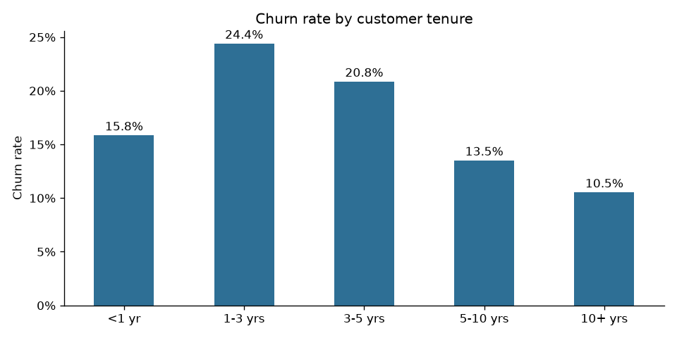
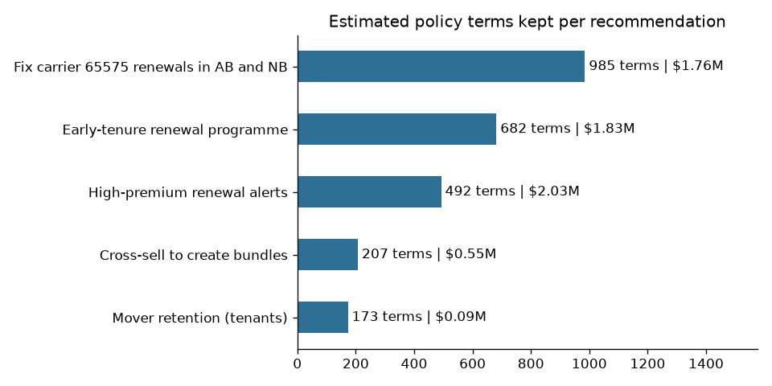
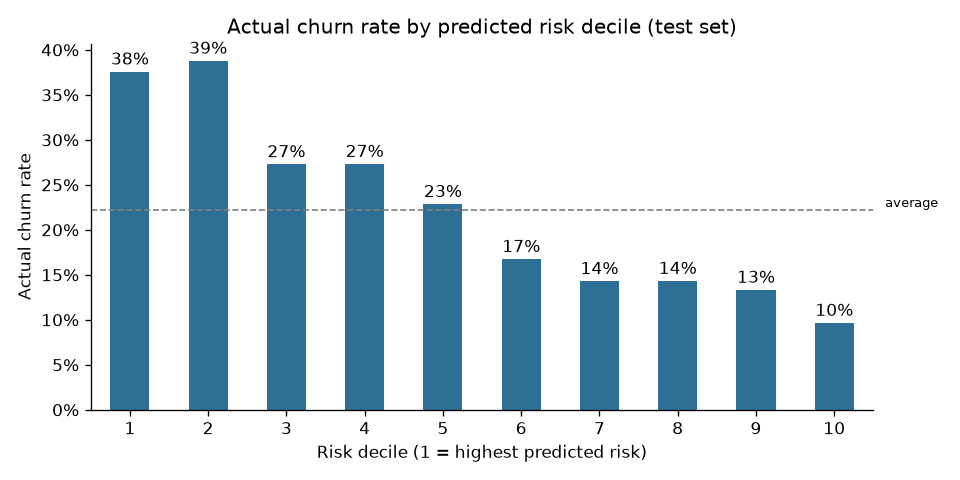
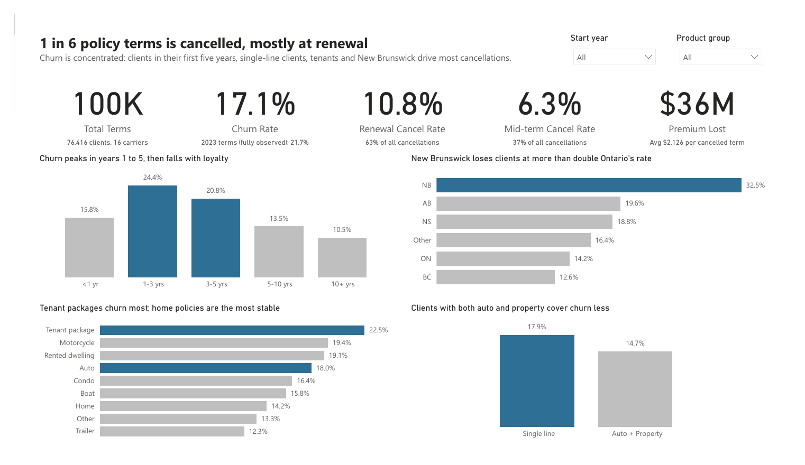
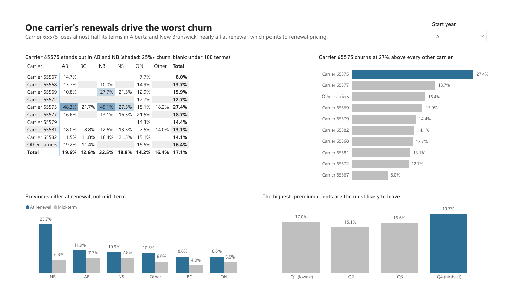
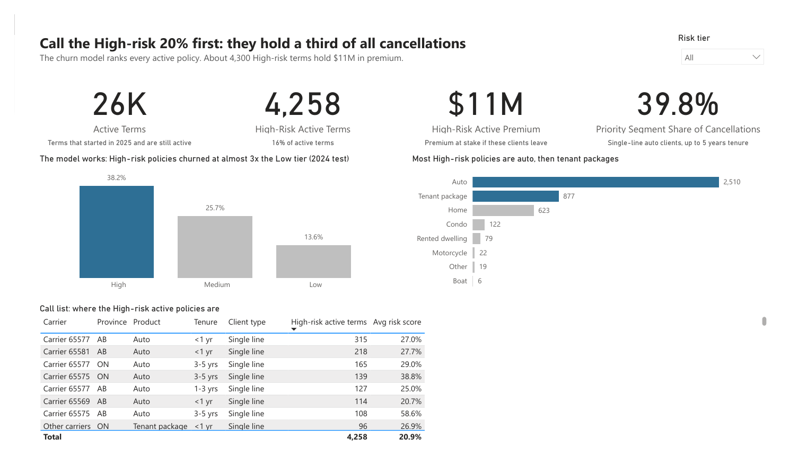

# Insurance Customer Churn Analysis

**Which insurance policies cancel, and where should a retention team focus?**
End-to-end analysis of ~100,000 Canadian auto and property policy terms (2023 to 2025): from raw Excel files to cleaned data, insights, SQL, a churn prediction model, a Power BI dashboard and a business report.

`Python` `pandas` `scikit-learn` `SQL (SQLite)` `Power BI` `DAX` `Jupyter` `Data cleaning` `EDA` `Machine learning` `Business recommendations`

**Author:** Ngan Nguyen · Personal portfolio project

**Business question:** what drives policy cancellations, and how can the business reduce churn?

> The dataset is anonymised and treated as fictional. Carriers appear only as numeric codes, and the figures are used for demonstration, not as statements about any real company.

## Key insights

- **Churn is a renewal problem:** 17.1% of terms cancel, 10.8% at renewal vs 6.3% mid-term.
- **One carrier is the biggest single leak:** carrier 65575 loses 48 to 49% of its terms in Alberta and New Brunswick, almost all at renewal, vs 16 to 19% for other carriers there. Without it, New Brunswick churn drops from 32.5% to 18.6%.
- **Years 1 to 5 are the danger zone:** churn is 24.4% at 1 to 3 years of tenure vs 10.5% after 10 years.
- **One segment drives 40% of cancellations:** single-line auto clients with up to 5 years of tenure.
- **Bundled clients stay longer:** 14.4% auto churn with a property policy vs 19.0% without.



## Recommendations to reduce churn

| Priority | Recommendation | Est. policies kept | Est. premium kept |
|---|---|---|---|
| 1 | Fix carrier 65575 renewals in AB and NB: re-quote at-risk clients with other carriers | ~985 | $1.76M |
| 2 | Early-tenure renewal programme: call single-line auto clients before their 2nd to 5th renewal | ~680 | $1.83M |
| 3 | Renewal price alerts for high-premium policies | ~490 | $2.03M |
| 4 | Cross-sell property cover to create bundled clients | ~205 | $0.55M |
| 5 | Mover retention for tenants who cancel mid-term | ~170 | $0.09M |

Each estimate uses an explicit, conservative assumption (see [notebook 04](notebooks/04_analysis_and_insights.ipynb), section 4.12). The levers overlap, so they are not fully additive. The plan includes a 12-month roadmap and a pilot with a control group to prove the effect.



## Predicting who will cancel

A gradient boosting model scores every policy by its risk of cancelling, so the retention team knows **whom to call first**.

- Trained on 2023 terms, tested **out-of-time** on January to September 2024 terms, using only information known when a term starts (no leakage).
- ROC AUC **0.66** (logistic regression baseline: 0.62).
- The **High** risk tier (top 20% of scores) churns at **38%** vs 14% for the Low tier, and holds **34% of all cancellations**.
- Renewal premium increases of 30%+ come with **18.3% churn vs 10.5%** when the price stays flat.



## Power BI dashboard

A three-page [Power BI project](powerbi/) built on the cleaned data and model scores, with 24 DAX measures:

| Page | What it shows |
|---|---|
| Executive Overview | KPIs (churn, renewal vs mid-term, premium lost) and churn by tenure, province, product and bundling |
| Churn Drivers | Carrier by province matrix, carrier ranking, renewal vs mid-term by province, premium quartiles |
| Retention Targeting | High-risk active policies and premium, model check by risk tier, call list by segment |

Designed with *Storytelling with Data* (Knaflic, 2015) principles: action titles that state the takeaway, a one-line Big Idea per page, grey bars with a single accent colour on the point being made, no redundant axes or gridlines, plain-language labels, a heatmap instead of a dense table, and context under every KPI.





### Open the interactive dashboard
1. Download this repository (**Code > Download ZIP**, or `git clone`) and unzip it.
2. Open `powerbi/Insurance Churn Dashboard.pbip` in [Power BI Desktop](https://www.microsoft.com/power-bi/desktop) (free, Windows).
3. The data loads from the saved cache, so all slicers and cross-filtering work straight away.

The data inside the dashboard is an anonymised copy: IDs are random numbers, dates are kept to the month and premiums are rounded to $10.

No Power BI? See the static export: [Power_BI_Dashboard.pdf](reports/Power_BI_Dashboard.pdf)

## How I approached it

| Step | Notebook | What I did |
|---|---|---|
| 1 | [Data understanding](notebooks/01_data_understanding.ipynb) | Defined the business questions, checked keys, joins and granularity |
| 2 | [Exploratory analysis](notebooks/02_exploratory_data_analysis.ipynb) | Profiled distributions and trends, logged 8 data quality issues, formed hypotheses |
| 3 | [Data cleaning](notebooks/03_data_cleaning.ipynb) | Fixed each issue, engineered features (tenure, bundling, driver age), validated with assertions |
| 4 | [Analysis and insights](notebooks/04_analysis_and_insights.ipynb) | Answered 7 questions, ran a robustness check, sized each recommendation |
| 5 | [SQL analysis](notebooks/05_sql_analysis.ipynb) | Re-answered key questions in [SQL](sql/churn_analysis.sql) with CTEs, joins and window functions; cross-checked with pandas |
| 6 | [Predictive model](notebooks/06_predictive_model.ipynb) | Built point-in-time features, compared two models out-of-time, created risk tiers, exported scores |
| 7 | [Power BI dashboard](powerbi/) | Data model, DAX measures and three report pages for managers |

**Final report:** [PDF (read online)](reports/Insurance_Churn_Report.pdf) · [Word](reports/Insurance_Churn_Report.docx)

## Things worth noting
- **Confounding check:** New Brunswick looked like a regional problem, but comparing carriers within each province showed it is mostly one carrier's renewals.
- **Right-censoring:** recent policies have not reached renewal yet, so churn looks artificially low for 2025. Findings were re-tested on 2023 to 2024 terms only and still hold.
- **Privacy:** name-based IDs, birth dates and postal codes were removed. The only row-level data published is the anonymised copy embedded in the Power BI dashboard.

## Data quality fixes
Duplicate province codes (NF/NL, MN/MB, NW/NT) and blanks · trailing whitespace · 1 undocumented record removed · 373 premium outliers flagged ($0.21 to $2.87M) · invalid driver ages set to missing

## Run it yourself
The raw data files are not included in this repository. With the three Excel files in `data/raw/`:
```
pip install -r requirements.txt
jupyter notebook notebooks/
```
Run notebooks 01 to 06 in order. Notebook 06 writes the dashboard data to `data/powerbi_public/policy_terms.csv`; open the `.pbip` and click **Refresh** to load it.

## Repository structure
```
├── notebooks/   6 step-by-step notebooks
├── sql/         SQL queries for the key business questions
├── powerbi/     interactive Power BI project with data cache (open the .pbip)
├── reports/     final report (PDF and Word) and dashboard PDF
├── images/      charts used in the README and report
└── data/        local only (raw, processed and dashboard data are not published)
```
